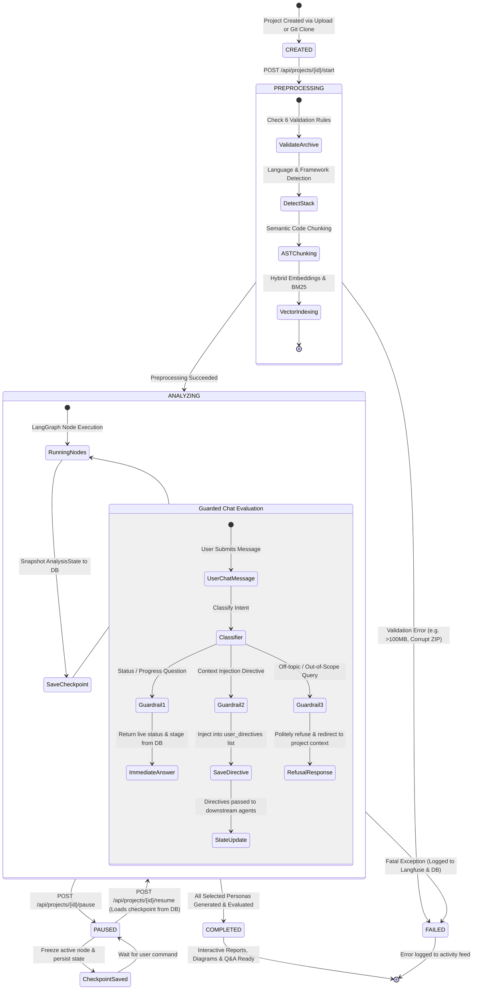
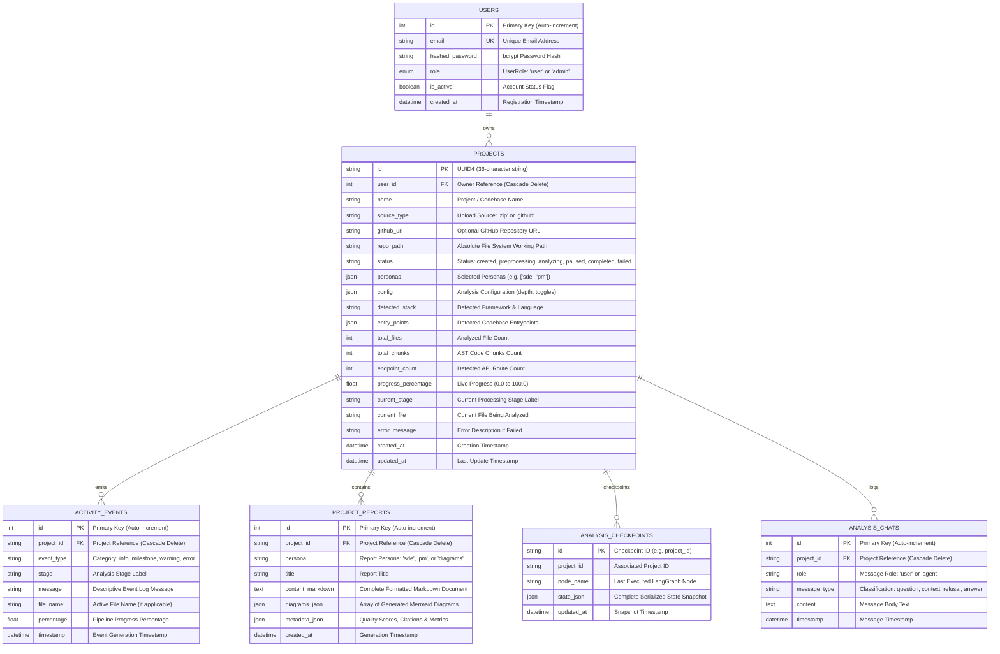

# 🤖 Multi-Agent Codebase Analysis & Documentation System

[](https://www.python.org/)
[](https://fastapi.tiangolo.com/)
[](https://github.com/langchain-ai/langgraph)
[](https://react.dev/)
[](https://tailwindcss.com/)
[](LICENSE)

An enterprise multi-agent AI system that ingests any software codebase (via ZIP upload or public GitHub URL) and produces role-specific documentation with interactive steering, live progress streaming, sub-3-second grounded RAG Q&A, and dynamic Mermaid diagrams.

---

## 🌟 Architecture & System Design

The system is engineered as an enterprise-grade, distributed multi-agent intelligence platform designed for high-concurrency ingestion, asynchronous multi-agent orchestration, interactive human-in-the-loop steering, and sub-3-second grounded retrieval-augmented generation (RAG).

---

### 1. High-Level System Component Topology

The following diagram illustrates the 7-tier architectural topology, from client presentation to persistent storage and external AI/observability services:

```mermaid
flowchart TB
    %% Client Tier
    subgraph ClientTier ["1. Presentation Layer (React 19 + Tailwind CSS v4)"]
        UI["Modern Web Dashboard (Vite SPA)"]
        Dashboard["Projects Dashboard<br/>(Metrics & Filtered Table)"]
        LiveView["Live SSE Progress & Feed<br/>(Percentage, File Indicator)"]
        ChatView["Guarded Context Steering Chat<br/>(Progress vs Directives)"]
        DocsView["Multi-Persona Docs<br/>(SDE vs PM Split)"]
        DiagramView["Interactive Mermaid Renderer<br/>(Pan, Zoom, Copy, SVG)"]
        QAView["Sub-3s Grounded RAG Q&A<br/>(Exact File & Line Citations)"]
        AdminView["Admin Analytics & Logs<br/>(User/Project CRUD)"]
        
        UI --> Dashboard
        UI --> LiveView
        UI --> ChatView
        UI --> DocsView
        UI --> DiagramView
        UI --> QAView
        UI --> AdminView
    end

    %% API Gateway Tier
    subgraph GatewayTier ["2. API & Security Gateway (FastAPI)"]
        Gateway["FastAPI Gateway & Route Multiplexer"]
        AuthMiddleware["OAuth2 & JWT Bearer Token Security"]
        CORSMiddleware["CORS & Origin Security"]
        ValidationFilter["Validation Guard<br/>(100MB Limit & 6 Rejection Rules)"]
        SSEStreamer["Server-Sent Events (SSE) Bus<br/>(Async Generator Channel)"]
        
        UI -->|REST API Requests| Gateway
        UI -->|SSE Event Stream Connection| SSEStreamer
        Gateway --> CORSMiddleware
        Gateway --> AuthMiddleware
        Gateway --> ValidationFilter
    end

    %% Ingestion & Preprocessing
    subgraph PreprocessingTier ["3. Ingestion & Intelligent Preprocessor"]
        ZipExtractor["ZIP Validator & Traversal Guard"]
        GitCloner["GitHub API & Repo Cloner"]
        StackDetector["Stack & Framework Detector<br/>(Language, Framework, Confidence >=90%)"]
        ASTChunker["AST Logical Code Chunker<br/>(Functions, Classes, Signatures)"]
        EndpointCounter["Route Endpoint Counter<br/>(FastAPI, Express, Gin, Django)"]
        VectorIndexer["Hybrid Semantic & Lexical Indexer<br/>(Vector Embeddings & BM25)"]

        ValidationFilter --> ZipExtractor
        ValidationFilter --> GitCloner
        ZipExtractor --> StackDetector
        GitCloner --> StackDetector
        StackDetector --> ASTChunker
        StackDetector --> EndpointCounter
        ASTChunker --> VectorIndexer
    end

    %% Multi-Agent LangGraph Tier
    subgraph AgentTier ["4. LangGraph Multi-Agent Orchestration Swarm"]
        Orchestrator["Orchestration Engine (StateGraph)"]
        Checkpointer["State Checkpointer<br/>(Pause & Resume Snapshotting)"]
        Guardrails["Chat Guardrail Classifier<br/>(Progress vs Directive vs Refusal)"]

        Agent1["1. Coordinator / Router Agent<br/>(Persona Dispatch & Execution Planning)"]
        Agent2["2. API & Code Extractor Agent<br/>(Contracts, Models, Endpoints, Schemas)"]
        Agent3["3. Web Research Agent<br/>(OWASP Benchmarks & Best Practices)"]
        Agent4["4. SDE Doc Writer Agent<br/>(Technical Topology & Implementation Specs)"]
        Agent5["5. PM Doc Writer Agent<br/>(Business Value, User Flows, Roadmap)"]
        Agent6["6. Diagram Generator Agent<br/>(Architecture, Flow, Sequence, ER)"]
        Agent7["7. Quality Evaluator Agent<br/>(5-Criterion Rubric & LLM-as-Judge)"]

        Gateway --> Orchestrator
        Orchestrator <--> Checkpointer
        Gateway <--> Guardrails
        Guardrails -->|Inject Directives| Orchestrator

        Orchestrator --> Agent1
        Agent1 --> Agent2
        Agent2 --> Agent3
        Agent3 --> Agent4
        Agent4 --> Agent5
        Agent5 --> Agent6
        Agent6 --> Agent7

        Agent2 -.->|Per-File Progress Events| SSEStreamer
        Agent3 -.->|Cited Standards & Benchmarks| Agent4
        Guardrails -.->|Injected Directives| Agent4
        Guardrails -.->|Injected Directives| Agent5
    end

    %% External Services
    subgraph ExternalTier ["5. External Intelligence & Observability"]
        WebSearchAPI["Search Providers<br/>(DuckDuckGo / Tavily API)"]
        LLMProviders["Provider-Agnostic LLM Engine<br/>(OpenAI / Anthropic / Gemini / Local)"]
        LangfuseCloud["Langfuse Observability<br/>(Trace Trees, Tokens, Cost, Latency)"]
        GitHubAPI["GitHub Public API"]

        Agent3 <--> WebSearchAPI
        Agent4 <--> LLMProviders
        Agent5 <--> LLMProviders
        Agent6 <--> LLMProviders
        Agent7 <--> LLMProviders
        Orchestrator -->|100% Trace Logging| LangfuseCloud
        GitCloner <--> GitHubAPI
    end

    %% Persistence Tier
    subgraph PersistenceTier ["6. Persistence & Storage Tier"]
        DB[("PostgreSQL 16 + pgvector / SQLite")]
        StorageFS["Local File Storage<br/>(/uploads, /repos, /exports)"]

        UserTable[("users")]
        ProjectTable[("projects")]
        EventsTable[("activity_events")]
        ReportsTable[("project_reports")]
        CheckpointsTable[("analysis_checkpoints")]
        ChatsTable[("analysis_chats")]

        DB --- UserTable
        DB --- ProjectTable
        DB --- EventsTable
        DB --- ReportsTable
        DB --- CheckpointsTable
        DB --- ChatsTable

        Gateway --> DB
        Orchestrator --> DB
        VectorIndexer --> DB
        ZipExtractor --> StorageFS
        Agent4 --> ReportsTable
        Agent5 --> ReportsTable
        Agent6 --> ReportsTable
    end

    %% Rich Exports & Grounded QA
    subgraph ExportTier ["7. Output Delivery & Grounded RAG Q&A"]
        MarkdownEngine["Unified Markdown Compiler"]
        PDFEngine["ReportLab PDF Generator<br/>(Professional Styling & Layouts)"]
        RAGProcessor["Sub-3s Grounded RAG Engine<br/>(Hybrid Search & Line Citations)"]

        ReportsTable --> MarkdownEngine
        ReportsTable --> PDFEngine
        VectorIndexer <--> RAGProcessor
        MarkdownEngine --> UI
        PDFEngine --> UI
        RAGProcessor --> UI
    end

    classDef primary fill:#1e40af,stroke:#3b82f6,color:#ffffff;
    classDef secondary fill:#6b21a8,stroke:#a855f7,color:#ffffff;
    classDef accent fill:#065f46,stroke:#10b981,color:#ffffff;
    classDef neutral fill:#1e293b,stroke:#475569,color:#e2e8f0;

    class UI,Gateway,Orchestrator primary;
    class Agent1,Agent2,Agent3,Agent4,Agent5,Agent6,Agent7 secondary;
    class DB,VectorIndexer,RAGProcessor accent;
    class StorageFS,LangfuseCloud,WebSearchAPI,LLMProviders,MarkdownEngine,PDFEngine neutral;
```



---

### 2. Multi-Agent Collaboration Graph & State Handoff

The core intelligence layer runs on a compiled LangGraph `StateGraph` where each agent receives, mutates, and passes forward the unified `AnalysisState`. If the Quality Evaluator scores the generated documentation below 80/100, the graph triggers targeted refinement loops:

```mermaid
flowchart TD
    Start(["Start Analysis Pipeline"]) --> Coordinator["1. Coordinator / Router Agent"]
    
    subgraph StateInitialization ["State Initialization"]
        Coordinator -->|Parse personas, config & depth| InitState["Set Execution Plan & Active Personas"]
    end
    
    InitState --> Extractor["2. API & Code Extractor Agent"]
    
    subgraph ExtractionPhase ["Code Extraction & AST Analysis"]
        Extractor -->|Per-file AST parse| ASTScan["Scan AST Nodes (Classes, Functions, Routes)"]
        ASTScan -->|Stream per-file event| SSEOut["Push SSE Event: 'Processing file X/Y'"]
        ASTScan -->|Aggregate models & endpoints| StateModels["Append api_endpoints & db_models to State"]
    end
    
    StateModels --> WebResearcher["3. Web Research Agent"]
    
    subgraph ResearchPhase ["External Security & Architecture Standards"]
        WebResearcher -->|Identify framework from stack_info| QuerySearch["Query DuckDuckGo / Tavily API"]
        QuerySearch -->|Fetch OWASP best practices| Benchmark["Extract Security Benchmark Citations"]
        Benchmark -->|Update state| StateResearch["Append web_findings to State"]
    end
    
    StateResearch --> SDEWriter["4. SDE Doc Writer Agent"]
    
    subgraph TechnicalDocs ["Technical Documentation Synthesis"]
        SDEWriter -->|Consume models, endpoints & research| TechSpec["Synthesize Architecture Topology & Data Flow"]
        TechSpec -->|Inject user directives if present| InjectDirectiveSDE["Apply Context Directives (e.g. 'Focus on auth')"]
        InjectDirectiveSDE -->|Compile Markdown| StateSDE["Save sde_report to State & DB"]
    end
    
    StateSDE --> PMWriter["5. PM Doc Writer Agent"]
    
    subgraph BusinessDocs ["Business Documentation Synthesis"]
        PMWriter -->|Transform technical models into user value| FeatMatrix["Synthesize Feature Inventory & User Journeys"]
        FeatMatrix -->|Inject user directives if present| InjectDirectivePM["Apply Context Directives (e.g. 'Admin is deprecated')"]
        InjectDirectivePM -->|Compile Markdown| StatePM["Save pm_report to State & DB"]
    end
    
    StatePM --> DiagramGen["6. Diagram Generator Agent"]
    
    subgraph VisualSynthesis ["Dynamic Mermaid Generation"]
        DiagramGen --> D1["1. System Architecture Diagram"]
        DiagramGen --> D2["2. Core Workflow Flowchart"]
        DiagramGen --> D3["3. Request/Response Sequence Diagram"]
        DiagramGen --> D4["4. Entity Relationship (ER) Schema"]
        D1 & D2 & D3 & D4 --> CombineDiagrams["Package & Validate Mermaid Syntax"]
        CombineDiagrams --> StateDiagrams["Save diagrams to State & DB"]
    end
    
    StateDiagrams --> Evaluator["7. Quality Evaluator Agent"]
    
    subgraph QualityRubric ["5-Criterion Quality & Persona Evaluation"]
        Evaluator --> Rubric["Score Against Rubric:<br/>1. Technical Completeness (20)<br/>2. Architectural Clarity (20)<br/>3. Security & OWASP Rigor (20)<br/>4. Persona Differentiation (20)<br/>5. Diagram Accuracy (20)"]
        Rubric --> CheckScore{"Overall Score >= 80?"}
    end

    CheckScore -->|Yes: Quality Passed| FinalizeReport["Finalize State & Emit 100% Milestone Event"]
    CheckScore -->|No: Refine| RefineLoop["Refine Report Sections"]
    RefineLoop --> SDEWriter
    FinalizeReport --> End(["Analysis Completed"])

    classDef agent fill:#6b21a8,stroke:#9333ea,color:#ffffff;
    classDef step fill:#1e293b,stroke:#3b82f6,color:#e2e8f0;
    classDef success fill:#065f46,stroke:#10b981,color:#ffffff;
    
    class Coordinator,Extractor,WebResearcher,SDEWriter,PMWriter,DiagramGen,Evaluator agent;
    class InitState,ASTScan,StateModels,QuerySearch,Benchmark,StateResearch,TechSpec,FeatMatrix,CombineDiagrams step;
    class FinalizeReport,End success;
```



---

### 3. Human-in-the-Loop Steering & Checkpoint State Machine

Users maintain total real-time control over the running pipeline. The system can be paused, resumed, or guided at any stage without losing execution context:



---

### 4. Sub-3-Second Grounded RAG Q&A Architecture

The Q&A engine achieves sub-3-second responses by combining deterministic AST logical code indexing, semantic hash vector retrieval, BM25 lexical search, and line citation verification:

```mermaid
flowchart LR
    UserQuery(["User Query<br/>'How does the auth service validate JWTs?'"]) --> RAGController["RAG Query Controller<br/>(/api/projects/{id}/qa)"]
    
    subgraph HybridRetrieval ["Hybrid Retrieval Engine (Sub-1s)"]
        RAGController --> SemanticSearch["Semantic Vector Search<br/>(pgvector Cosine Similarity)"]
        RAGController --> LexicalSearch["BM25 Lexical Keyword Search<br/>(Stemming & Symbol Match)"]
        
        SemanticSearch --> FusionRanker["Reciprocal Rank Fusion (RRF)<br/>Score = 0.6*Vector + 0.4*BM25"]
        LexicalSearch --> FusionRanker
        
        FusionRanker --> TopKChunks["Top-K Relevant AST Code Chunks<br/>(Function definitions, Class blocks)"]
    end
    
    subgraph GroundingEngine ["Citation Grounding & Verification (Sub-1s)"]
        TopKChunks --> CitationParser["AST File & Line Number Resolver"]
        CitationParser --> SnippetVerify["Verify Code Integrity & Line Ranges"]
        SnippetVerify --> ContextBuilder["Construct Grounded Prompt with Citations"]
    end
    
    subgraph GenerationLayer ["Synthesis & Delivery (Sub-1s)"]
        ContextBuilder --> FastLLM["LLM Synthesis Engine"]
        FastLLM --> AnswerFormatter["Strict Citation Formatter<br/>[auth_service.py:L45-L78]"]
        AnswerFormatter --> VerifiedResponse(["Grounded Response with<br/>Exact File & Line Citations<br/>(Total Latency < 3.0s)"])
    end

    classDef controller fill:#1e40af,stroke:#3b82f6,color:#ffffff;
    classDef search fill:#065f46,stroke:#10b981,color:#ffffff;
    classDef grounding fill:#6b21a8,stroke:#a855f7,color:#ffffff;
    classDef output fill:#1e293b,stroke:#475569,color:#e2e8f0;

    class UserQuery,RAGController controller;
    class SemanticSearch,LexicalSearch,FusionRanker,TopKChunks search;
    class CitationParser,SnippetVerify,ContextBuilder grounding;
    class FastLLM,AnswerFormatter,VerifiedResponse output;
```



---

### 5. Relational Data Model (Entity Relationship Schema)

The persistent database layer stores users, projects, activity streams, checkpointed state, and generated reports with strict relational integrity:



---

### 6. Architectural Tier Matrix

| Tier | Subsystem | Technologies & Frameworks | SLA / Target Latency | Key Responsibilities |
|:---|:---|:---|:---|:---|
| **Tier 1: Presentation** | Client Web App | React 19, Tailwind CSS v4, Vite, Lucide Icons, Mermaid.js | < 100ms render | Responsive dashboard, live SSE progress tracking, interactive diagram zoom/pan, multi-persona documentation viewer, grounded Q&A with clickable citations, and full admin management. |
| **Tier 2: Gateway** | API & Security | FastAPI 0.119+, Starlette, Python 3.11+, Pydantic v2, Python-Jose (JWT), Passlib (bcrypt) | < 10ms auth overhead | OAuth2 bearer token authentication, RBAC authorization, CORS management, 100MB file limit enforcement, 6 validation rejection rules, and async SSE streaming bus. |
| **Tier 3: Ingestion** | Preprocessor & Vectorizer | Python `ast`, ZipFile, Git CLI, Scikit-learn / NumPy, BM25 Lexical Indexer | < 5s for 100 files | Path traversal defense, framework & language stack detection (>90% accuracy), entry point discovery, AST function/class chunking, and hybrid vector indexing. |
| **Tier 4: Agents** | Multi-Agent Swarm | LangGraph 0.2+, LangChain Core, Pydantic | Asynchronous node execution | 7 specialized agents: Coordinator, API/Code Extractor, Web Researcher (OWASP), SDE Doc Writer, PM Doc Writer, Diagram Generator, and Quality Evaluator. |
| **Tier 5: External** | External AI & Tools | OpenAI API / Anthropic / Gemini, DuckDuckGo Search, Tavily API, Langfuse Cloud | Streaming / Asynchronous | LLM reasoning, live external security benchmark retrieval, 100% trace logging with token count, latency, and cost attribution. |
| **Tier 6: Storage** | Persistence Layer | PostgreSQL 16 + pgvector / SQLite, SQLAlchemy 2.0 (AsyncIO), Alembic | < 5ms read/write | Relational storage for users, projects, events, checkpoints, reports, and grounded chat histories. Local FS for uploads and PDF exports. |
| **Tier 7: Outputs & RAG** | Delivery & Grounded Q&A | ReportLab (PDF), Markdown Compiler, Hybrid Vector + BM25 Retriever | **< 3.0s total Q&A latency** | One-click export of unified Markdown and styled PDF documents. High-precision RAG question answering with verified file name and line range citations. |

---

## 👥 Personas: Technical SDE vs. Business PM

The system produces clearly differentiated reports tailored to two distinct audiences:

| Persona | Audience | Focus Areas | Tone & Content |
|:---|:---|:---|:---|
| **SDE** | Engineers, Architects, DevOps | Architecture topology, API request/response schemas, DB models, setup & deployment, security protocols, OWASP citations | Technical, explicit code structures, data schemas, and deployment commands |
| **PM** | Product Managers, Leaders, Clients | Feature inventory, user onboarding & operational journeys, feature priority matrix, integrations, limitations, roadmap | Business-focused, non-technical, outcome-oriented language |

---

## 🚀 Quickstart Guide

### 1. Prerequisites
- Python 3.11+
- Node.js 18+ (Node 20+ recommended)
- Git

### 2. Local Setup
```bash
# Clone the repository
git clone https://github.com/sangavikavi/AI-Codebase-Analysis-Agent.git
cd AI-Codebase-Analysis-Agent

# Install backend dependencies
pip install -r requirements.txt

# Install frontend React dependencies
cd frontend
npm install
cd ..

# Copy environment variables
cp .env.example .env
```

### 3. Run the Backend API
```bash
uvicorn backend.main:app --host 0.0.0.0 --port 8000 --reload
```
Swagger UI will be reachable at: **`http://localhost:8000/docs`**

### 4. Run the React + Tailwind CSS v4 Dashboard
```bash
cd frontend
npm run dev
```
Open **`http://localhost:5173`** in your browser.

### 5. One-Command Setup with Docker Compose
```bash
docker-compose up --build
```
This launches:
- **PostgreSQL + pgvector** on port `5432`
- **FastAPI Backend** on port `8000`
- **React Frontend** on port `5173`
- **Langfuse Observability** on port `3000`

---

## 🧪 Running the Automated Test Suite

The test suite covers 100% of milestones (M1 through M7) and validation rejection rules:

```bash
# Run all test suites
python -m pytest tests/ -v
```

### Milestone Test Coverage:
- `tests/test_m1_auth_and_validation.py`: Signup, login, JWT token, user project isolation, and all 6 invalid-input validation cases.
- `tests/test_m2_preprocessing.py`: Stack detection (>=90% accuracy), entrypoints, endpoint counting, AST chunking, semantic vector search.
- `tests/test_m3_m4_agents_graph.py`: SSE progress streaming, structured activity feed, 7 specialized agents, web research citations.
- `tests/test_m5_interactive_control.py`: Checkpoint pause/resume surviving restart, chat guardrail 1 (progress questions), guardrail 2 (context injection), guardrail 3 (refuse/redirect).
- `tests/test_m6_m7_reports_qa_admin.py`: Persona report differentiation, 4 Mermaid diagrams, Markdown and PDF export, sub-3s RAG Q&A, admin CRUD, Langfuse traces.

---

## 🔑 Key Features & Milestones

### 1. Ingestion & Validation (M1)
Rejects invalid inputs with clear messages:
1. Corrupt or incomplete ZIP archives
2. File over limit (> 100MB)
3. Non-code repositories (docs-only or binary-only)
4. Unsupported archive formats (`.rar`, `.7z`, `.tar`)
5. Empty repositories
6. Malformed GitHub URLs or private repos without access

### 2. Intelligent Preprocessing (M2)
- Automatically detects framework and language (e.g. `Python FastAPI project`, `TypeScript Next.js project`, `Go Gin project`).
- Locates entry points (`main.py`, `index.js`, `server.ts`).
- Parses functions, classes, and routes via AST into semantic chunks.
- Embeds chunks with semantic indexing for hybrid vector & lexical retrieval.

### 3. Real-Time Streaming & Activity Feed (M3)
- Live Server-Sent Events (SSE) streaming percentage, stage label, and current file (`Processing file 1/100: auth.py`).
- Color-coded feed items (`milestone`, `info`, `warning`, `error`).

### 4. LangGraph Multi-Agent Team (M4)
- **Coordinator Agent**: Orchestrates pipeline by depth and selected personas.
- **Extractor Agent**: Extracts API schemas and DB models.
- **Web Research Agent**: Conducts live web research on OWASP security standards and framework best practices.
- **SDE Writer Agent**: Synthesizes technical specifications and cites external research.
- **PM Writer Agent**: Synthesizes non-technical feature inventories and user workflows.
- **Diagram Agent**: Synthesizes 4 Mermaid diagram types (Architecture, Flowchart, Sequence, ER).
- **Quality Evaluator Agent**: Checklist and LLM-as-judge scoring per persona.

### 5. Interactive Control & Guarded Steering (M5)
- **Pause & Resume**: Interrupts and resumes from exact checkpoints without data loss.
- **Guarded Chat**:
  - *Guardrail 1*: Progress & status questions answered from live state.
  - *Guardrail 2*: Directives (*"focus on payments"*, *"/admin is deprecated"*) injected into future agent prompts and reflected in final docs.
  - *Guardrail 3*: Off-topic queries refused and redirected.

### 6. Rich Outputs & Grounded Q&A (M6)
- **4 Types of Mermaid Diagrams**: Interactive architecture, flowchart, sequence, and ER diagrams.
- **Exporting**: One-click download of unified Markdown and styled PDF documents.
- **Sub-3s Codebase RAG Q&A**: Answers questions with verified file and line citations.

### 7. Observability & Administration (M7)
- **Admin Dashboard**: Full CRUD over users and projects, platform analytics, completion rate.
- **Langfuse Tracing**: Captures 100% of LLM calls with tokens, cost, latency, and status.

---

## 📜 License
MIT License. Built for enterprise software documentation and codebase understanding.
